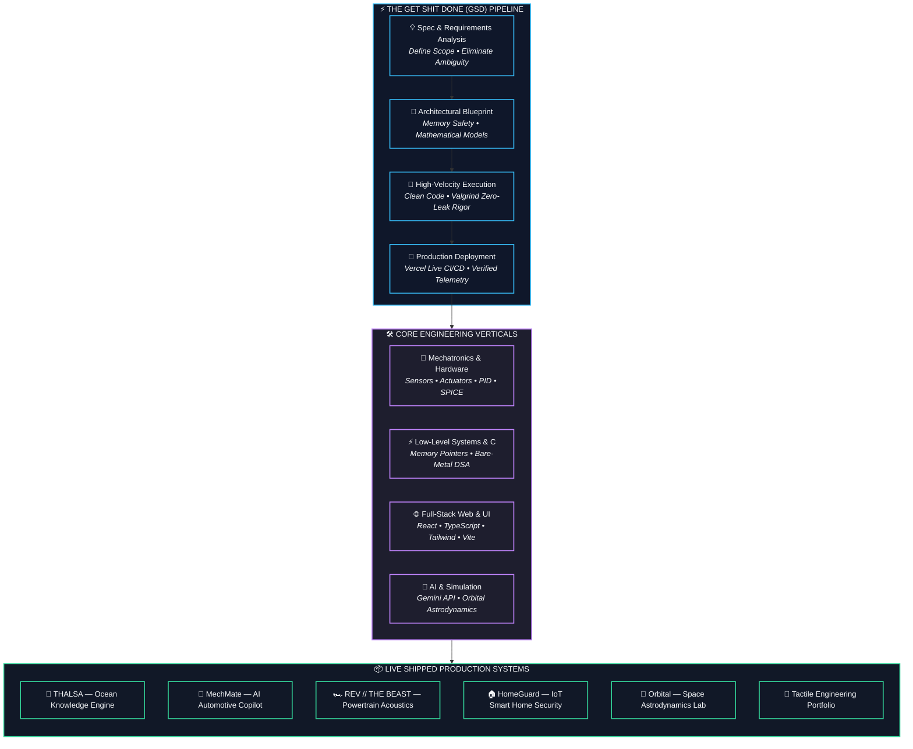
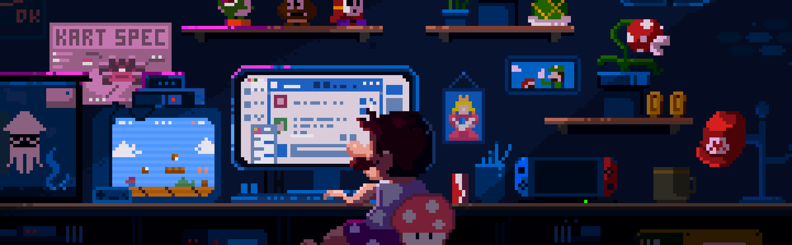

<div align="center">

<!-- Animated Header Banner -->


<br/><br/>

<!-- Featured Live Portfolio & Quick Access Badges -->
<a href="https://portfolio-lac-two-76.vercel.app/" target="_blank">
  
</a>
&nbsp;
<a href="https://komarev.com/ghpvc/?username=shubhamkerure07&label=PROFILE+VIEWS&style=for-the-badge&color=0284c7" target="_blank">
  
</a>

<br/><br/>

<!-- Social Badges -->
<a href="https://github.com/shubhamkerure07" target="_blank">
  
</a>
&nbsp;
<a href="https://www.linkedin.com/in/shubham-kerure-23350938b" target="_blank">
  
</a>
&nbsp;
<a href="mailto:shubhamkerure13@gmail.com">
  
</a>

<br/><br/>

<!-- Mascot Animation -->


<br/><br/>

<!-- Animated Divider -->


<!-- Quick Navigation Pill Bar -->
<p align="center">
  <b><a href="#-about-me">👨‍💻 ABOUT</a></b> &bull;
  <b><a href="#-the-get-shit-done-gsd-philosophy">⚡ GSD ETHOS</a></b> &bull;
  <b><a href="#-engineering-graph--work-distribution">📊 WORK GRAPH</a></b> &bull;
  <b><a href="#-live-production-systems">🚀 LIVE APPS</a></b> &bull;
  <b><a href="#-featured-engineering-projects">🏆 PROJECTS</a></b> &bull;
  <b><a href="#-engineering-disciplines--tech-stack">🛠️ TECH STACK</a></b> &bull;
  <b><a href="#-lets-connect">📬 CONNECT</a></b>
</p>


</div>

<br/>

## 👨‍💻 About Me

* 🎓 **Mechatronics Engineering Student** @ **Mangalore Institute of Technology & Engineering (MITE)**.
* 🤖 Engineering at the convergence of **Robotic Control, Vehicle Dynamics, and Embedded C/C++**.
* 🌐 Architecting high-velocity, real-world **Modern Web Applications & AI Assistant Engines**.
* 🏎️ Deeply passionate about **Automotive Powertrains, Engine Acoustics & Symplectic Physics Simulation**.
* ⚡ Core Philosophy: **"Zero fluff, rigorous math, clean memory, and ship to production."**

> *"I combine engineering hardware logic with modern software systems to build functional, real-world tools that solve concrete problems."*

<br/>

<div align="center">
  
</div>

<br/>

## ⚡ The "Get Shit Done" (GSD) Philosophy

I approach every project with an uncompromising **bias for action** and **engineering discipline**:

```
🎯 SPEC & ARCHITECT      🔨 BUILD & VERIFY        🚀 SHIP TO PROD
   Clear scope & specs       Valgrind 0 leaks         Vercel 99.9% uptime
   No bloated fluff          Math-sound algorithms    Instant user value
```

* 📐 **Spec-First, Code-Fast:** Defining architectural constraints and mathematical bounds before touching a line of code.
* 🛡️ **Zero-Leak Memory & Mathematical Rigor:** Bare-metal C with leak-free allocations, deterministic state, and verified physics constants.
* 🚢 **Bias for Deployed Software:** Software is only real when users can interact with it live on production.

<br/>

<div align="center">
  
</div>

<br/>

## 📊 Engineering Graph & Work Distribution

### 🎨 Work Distribution & Engineering Focus Matrix
<div align="center">
  
</div>

<br/>

### 📐 The Architecture of My Work (GSD Pipeline & Verticals)



<br/>

### 📈 GitHub Engineering Activity & Streak Metrics

<div align="center">
  <a href="https://github.com/shubhamkerure07" target="_blank">
    
  </a>
  &nbsp;&nbsp;
  <a href="https://github.com/shubhamkerure07" target="_blank">
    
  </a>
</div>

<br/>

<div align="center">
  <a href="https://github.com/shubhamkerure07" target="_blank">
    
  </a>
</div>

<br/>

<div align="center">
  
</div>

<br/>

## 🚀 Live Production Systems

All applications below are live in production, fully responsive, and available for immediate interactive testing:

<div align="center">

| Application | Production Status | Live Demo | Repository | Core Engineering Highlights |
| :--- | :---: | :--- | :--- | :--- |
| 🌊 **THALSA** |  | [](https://thalsa.vercel.app/) | [](https://github.com/shubhamkerure07/thalsa) | Calibrated 2–10 marks depth answer engine, LaTeX formulas & real-time telemetry. |
| 🔧 **MechMate** |  | [](https://mechmate-sigma.vercel.app) | [](https://github.com/shubhamkerure07/mechmate) | Google Gemini AI automotive diagnostic copilot with localized OBD-II triage. |
| 🏎️ **REV // THE BEAST** |  | [](https://rev-the-beast.vercel.app/) | [](https://github.com/shubhamkerure07/REV-THE-BEAST-) | High-displacement engine acoustics simulator powered by HTML5 Web Audio API. |
| 🏠 **HomeGuard** |  | [](https://homeguard-app.vercel.app/) | [](https://github.com/shubhamkerure07/HomeGuard) | Modern smart home defense & IoT telemetry with interactive 2D floor plans. |
| 🌌 **Orbital** |  | [](https://orbital-nu-gules.vercel.app/) | [](https://github.com/shubhamkerure07/orbital) | Symplectic Velocity Verlet integrator, 3D planetarium & Keplerian ephemerides. |
| 💼 **Portfolio** |  | [](https://portfolio-lac-two-76.vercel.app/) | [](https://github.com/shubhamkerure07/portfolio) | Personal mechatronics portfolio with interactive Web Audio tactile dynamics. |

</div>

<br/>

<div align="center">
  
</div>

<br/>

## 🏆 Featured Engineering Projects

### ⚡ [Low-Level Systems Programming & Data Structures in C](https://github.com/shubhamkerure07)
* Bare-metal implementation of core data structures (dynamic arrays, hash tables, linked lists, binary trees) in ISO C99.
* Rigorous pointer arithmetic and memory management validated with **Valgrind** to guarantee 0 memory leaks and 0 buffer overflows.
* Circuit and electronics modeling via SPICE netlists (`Exp1/Exp2` rectifier & transistor characteristic curves).

### 🌊 [THALSA — Ocean Knowledge & Exam Telemetry Engine](https://github.com/shubhamkerure07/thalsa)
* Full-stack student learning platform featuring an ocean-depth answer engine calibrated for 2–10 mark technical questions.
* Integrated with KaTeX mathematical equation rendering and real-time telemetry analytics.
* **[Live App](https://thalsa.vercel.app/)** &bull; **[GitHub Repo](https://github.com/shubhamkerure07/thalsa)**

### 🔧 [MechMate — AI Automotive Diagnostic Assistant](https://github.com/shubhamkerure07/mechmate)
* Intelligent diagnostic copilot built for mechanics, car enthusiasts, and vehicle owners.
* Powered by Google Gemini AI to analyze vehicle symptoms, decode OBD-II fault codes, and generate actionable repair instructions.
* **[Live App](https://mechmate-sigma.vercel.app/)** &bull; **[GitHub Repo](https://github.com/shubhamkerure07/mechmate)**

### 🪐 [ORBITAL — Deep Space Simulation & Astrodynamics Lab](https://github.com/shubhamkerure07/orbital)
* High-precision aerospace mission-control console and digital planetarium built with React 18, Three.js, and TypeScript.
* Powered by an analytical SI astrophysical engine and an energy-conserving Symplectic Velocity Verlet gravitational integrator.
* Features near-Earth asteroid tracking (34,850+ asteroids) and exoplanet transit spectroscopy.
* **[Live App](https://orbital-nu-gules.vercel.app/)** &bull; **[GitHub Repo](https://github.com/shubhamkerure07/orbital)**

### 📱 [Native Android Systems](https://github.com/shubhamkerure07)
* **[EduClass (Edu Made Easy)](https://github.com/shubhamkerure07/edu-made-easy)** — Native Android tuition & interactive classroom platform with real-time class notifications and quiz management.
* **[StudentHub](https://github.com/shubhamkerure07/student-manager)** — Android academic planner with auto-alarms, attendance margin calculations, and Canvas expense tracking.
* **[MITE Contineo Enhanced](https://github.com/shubhamkerure07/mite-contineo-webs-enhanced-version)** — Modernized campus academic portal redesign with attendance margin predictors and AI integration.

<br/>

<div align="center">
  
</div>

<br/>

## 🛠️ Engineering Disciplines & Tech Stack

<div align="center">

| Domain | Verified Tools & Technologies |
| :--- | :--- |
| **Languages** |       |
| **Web & UI** |       |
| **Mobile Development** |    |
| **AI & APIs** |    |
| **Mechatronics & Embedded** |      |
| **Dev Tools & Workflow** |      |

</div>

<br/>

<div align="center">
  
</div>

<br/>

## 📬 Let's Connect

Whether you're exploring my live projects, discussing mechatronics engineering and robotics, or looking to collaborate on high-performance systems:

<div align="center">

<br/>

<a href="mailto:shubhamkerure13@gmail.com">
  
</a>
&nbsp;&nbsp;
<a href="https://portfolio-lac-two-76.vercel.app/" target="_blank">
  
</a>
&nbsp;&nbsp;
<a href="https://www.linkedin.com/in/shubham-kerure-23350938b" target="_blank">
  
</a>

<br/><br/>



<br/><br/>

**⚡ Engineered with precision &bull; Shipped with purpose &bull; Built to Get Shit Done.**

</div>
